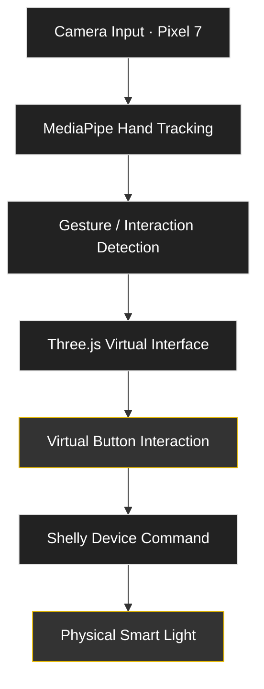

# SE7ENX — Gesture Control

<p align="center">
  
  
</p>

<h3 align="center">Control the physical world with a gesture.</h3>

<p align="center">
  A computer vision experiment connecting hand tracking, interactive 3D interfaces, and real-world IoT hardware.
</p>

<p align="center">
  <a href="https://github.com/Ab40D">GitHub</a> •
  <a href="https://se7en-bay.vercel.app/">Portfolio</a>
</p>

---

## Overview

What if you could control real-world devices using nothing but your hands and a camera?

**SE7ENX Gesture Control** explores touchless interaction between humans and connected hardware.

By combining computer vision, real-time hand tracking, and an interactive 3D interface, this project demonstrates how natural hand movements can become commands for physical devices.

The current prototype uses a virtual button to control a real smart light through a Shelly Gen3 2PM.

The objective is to explore a different approach to human-computer interaction, where digital interfaces become a bridge to the physical world.

## Technology Stack

<p align="center">
  
  
  
  
  
  
</p>

| Technology | Role |
|:---|:---|
| MediaPipe | Real-time hand tracking |
| Three.js | Interactive 3D interface |
| JavaScript | Application logic |
| Computer Vision | Hand landmark detection |
| Shelly Gen3 2PM | Physical lighting control |
| Google Pixel 7 | Camera input |

## How It Works

The system connects human gestures to real hardware through a simple interaction pipeline.



### Interaction Flow

1. The camera captures the user's hand.
2. MediaPipe detects hand landmarks.
3. The application processes the hand position.
4. The virtual interface responds to the interaction.
5. A command is sent to the Shelly device.
6. The real lighting load changes state.

## Hardware Setup

| Component | Description |
|:---|:---|
| Google Pixel 7 | Camera and tracking input |
| Shelly Gen3 2PM | Smart relay |
| Lighting Load | Real-world output |
| Local Network | Device communication |

## Demonstration

**Virtual Interaction → Physical Response**

The current demonstration focuses on one practical example: switching a real light ON and OFF through an interactive virtual button.

The virtual interface is not just a visual simulation. It is connected to actual electrical hardware.

> Add your demonstration video or GIF here.

```md

```

## Future Directions

The project is an experimental foundation for exploring:

- Touchless smart home interaction.
- Spatial computing and 3D interfaces.
- Gesture-based building automation.
- KNX and MQTT integration.
- Multi-device control.
- Interactive digital environments.
- More advanced computer vision capabilities.

The same interaction model could eventually extend beyond lighting to other connected devices and intelligent environments.

## Project Status


This is an independently developed prototype and an ongoing engineering experiment.

## Author


## Connect & Follow the Experiment

<p align="center">
  <a href="https://lnkd.in/p/dpwF8xc3">
    
  </a>
</p>

<p align="center">
  <sub>See the original experiment, development process, and real-world demonstration.</sub>
</p>


**Abdelkhalek Mammeri**

Electronics · Embedded Systems · IoT · Automation · Computer Vision

- GitHub: [@Ab40D](https://github.com/Ab40D)
- Portfolio: [SE7ENX](https://se7en-bay.vercel.app/)

---

<p align="center">
  <strong>SE7ENX</strong>
  <br/>
  Rethinking Human Interaction with Technology.
  <br/><br/>
  <sub>Built independently. Driven by curiosity. Designed for possibilities.</sub>
</p>
